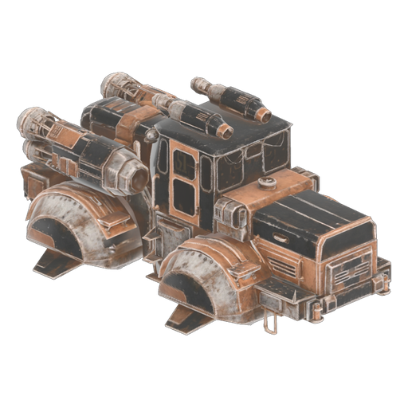

# Rustbound Vessel

New fast enclosed hover vessel, powered by Vehicle Framework.

<!-- source-only-sync -->
## Current source candidate

Source version **0.4.0** is saved from workshop revision `ca32bbf79ce0840d5166a232bdb3a9fdcd761254`. The retained installable payload remains **0.4.0** with its original bytes. This source update does not rebuild or requalify that payload. The current source and metadata define the candidate; gameplay, rendered behavior and co-op remain unqualified for rebuilt bytes.
<!-- /source-only-sync -->

## Install

Install [Moon Sweepers Mod Loader](https://github.com/swooping-mods/moon-sweepers-mod-loader) first.

Download [rustbound-vessel-0.4.0.msmod](content/rustbound-vessel-0.4.0.msmod), then drag and drop the `.msmod` file onto the [Moon Sweepers Mod Loader](https://github.com/swooping-mods/moon-sweepers-mod-loader) window. You can also use **Add mods…** (older loader builds: **Install mod package**).

Select the mod and its required frameworks, click **Prepare files**, then **Launch**.

Required mods: [vehicle-framework](https://github.com/swooping-mods/vehicle-framework).

## Controls

- Start Game > Slot 1 > Invite Only > Play. Buy Rustbound Hover Vessel ($1,500) from a garage.
- Shift+F9 lift/land; W/S fly; A/D turn; Space/Ctrl climb; Z/C strafe; Shift boost; X brake.
- Private scenario shortcuts: F10 gives test funds and opens the shop; F11 turns the camera; F12 pitches down.

## Compatibility

Version 0.4.0. Targets the pinned Steam Windows x64 IL2CPP build of Moon Sweepers (Steam app 5335510). On Linux, the game runs through Proton. Experimental: back up saves before using save-affecting mods.

## Build

Run `python3 build.py --check` to verify source hashes, then `python3 build.py` to write a build under `.local/build/`. Requires installed Clang, lld-link and llvm-dlltool.

## Credits

See [CREDITS.txt](CREDITS.txt) and [third-party notices](vendored/THIRD_PARTY_NOTICES.md).
